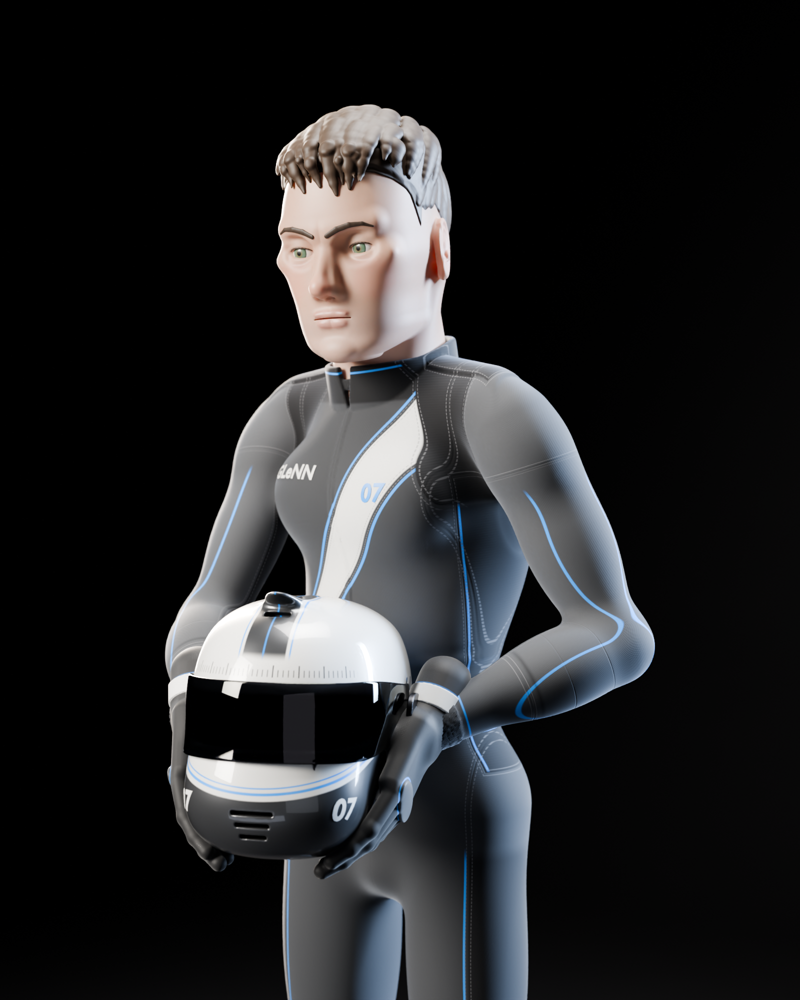

# GLeNN driver: "07"

An original, fictional elite racing driver for GLeNN. He reads as a young,
aggressive, focused European driver, but he is not a likeness of any real
person. His face, hair, suit and helmet were all designed for GLeNN. The team
identity is the fictional GLeNN outfit with the driver number 07. There are no
real teams, sponsors, logos or existing helmet patterns.

The style is a premium stylised animated look rather than photoreal. That
means sculpted planes, slightly larger eyes framed by a graphic lash line,
clean hair masses with pointed fringe clumps, and painterly skin.



## Design

| Part | Notes |
| --- | --- |
| Face | Broad forehead, natural strong jaw, high cheekbones and a compact lower face. The brows are short, low and slightly drawn in. The eyes are deep set and narrowed: the upper lid sits on the iris. The expression is calm, focused and competitive. |
| Hair | Short faded sides with low-relief clumps. The longer textured top is pushed forward and to his left, and nine fringe clumps end in clean points above the brows. |
| Body | Lean and athletic, with moderately broad shoulders, a strong neck and a narrow waist. |
| Suit | Matte graphite with black side panels and inner sleeves. A white asymmetric "blade" runs from the left shoulder to the right hip. Electric-blue pinstripes are used sparingly. It has raglan sleeves, shoulder epaulettes, a quilted belt, a stand collar with a centre zip, knit cuffs and dashed stitching along every seam. "GLeNN" appears on the chest, back and belt, and the number 07 is on the chest. |
| Gloves and boots | Black gloves with a graphite back, a knuckle guard, a white cuff strap and silicone palm dots. Black boots with a white heel panel and a blue pin line. |
| Helmet | White base with a graphite "speed blade" sweeping back from the eye-port. Two blue pin lines follow it (speed). A precision tick scale runs above the visor (precision). A graphite spine stripe with a blue centre line runs over the crown (control). It has a dark tinted visor with a thin-film sheen, metallic pivot covers, a top intake, a rear spoiler lip, chin vents, a clear coat and micro-scratches. |

## Files

| File | What it is |
| --- | --- |
| `glenn_driver.blend` | The scene: the neutral stance, the hero pose holding the helmet, the helmet on a display plinth, the studio and the 10 presentation cameras. It is saved at the lighter `blend` mesh density (about 0.9M vertices, 39 MB) to keep the repository small. The renders use `final` density. |
| `renders/` | The 10 presentation views listed below. |
| `build_glenn_driver.py` | Builds everything, then renders and saves. This is the entry point. |
| `shapes_head.py` | Head, eyes, lids, ears, brows, lash line and hair. |
| `shapes_body.py` | Body and suit, gloves, boots, the pose system and arm IK. |
| `shapes_helmet.py` | Helmet shell, visor and hardware. |
| `materials.py` | All shaders. They are procedural, so the .blend has no external textures. |
| `sdf_core.py`, `shader_dsl.py`, `blender_util.py` | The signed-distance modelling kernel, a small expression-to-node compiler for the shaders, and Blender helpers. |

The renders are listed below. `00_contact_sheet.jpg` shows all ten on one page.

1. `01_front_ortho`, `02_side_ortho`, `03_rear_ortho`: orthographic turnaround
2. `04_three_quarter`: full-body three-quarter view
3. `05_hero_three_quarter`: the hero shot. It is waist-up, with the helmet in both hands and his eyes looking just past the lens.
4. `06_face_closeup` and `07_helmet_closeup`
5. `08_wireframe`: the real render mesh on the face, not a proxy, so the uniform voxel quads are visible
6. `09_clay_sculpt`: the sculpt without materials
7. `10_final_material`: full materials

## Rebuilding

The geometry is generated, not hand-sculpted, so the whole asset can be rebuilt
and tweaked from code.

```bash
# Blender 4.2+ (numpy ships with Blender)
blender -b -P build_glenn_driver.py -- --quality final --renders renders --blend glenn_driver.blend

# or with the bpy module from PyPI (pip install bpy numpy)
python build_glenn_driver.py --quality preview --renders /tmp/glenn_preview
```

`--quality` is one of `draft`, `preview`, `blend` or `final`. It sets the mesh
density and the render samples. The committed .blend uses `blend` and the
renders use `final`, at 64 samples on CPU with denoising. `--views 05_hero_three_quarter` renders a subset, and
`--groups neutral` builds only one setup.

These are useful knobs:

- `shapes_body.HEAD_SCALE`: head-to-body ratio. It is 1.14 for the stylised read.
- `shapes_head.FRINGE`: one entry per fringe clump, giving its root, its tip and its width.
- `shapes_head.EYE_R`, `IRIS_R` and `_lid_planes`: eye size and how narrowed the eyes are.
- `build_glenn_driver.HERO_HELMET`: where the helmet sits in the hero shot. The arms are solved to it automatically.
- The palette at the top of `materials.py`.

## How it is made, and what still needs an artist

Every form is a signed distance field built from primary, secondary and
tertiary shapes, then meshed into quads. Each pose is re-evaluated through
forward kinematics, so the hero pose is sculpted in pose rather than deformed.
This makes a consistent, original, fully editable first pass. It is not a
production game asset yet. A production pass needs:

- **Retopology.** The meshes are uniform voxel quads: dense, with no edge
  flow around the eyes, mouth or joints. Game-ready versions need retopology
  to a sensible budget, for example 25 to 40k triangles for the body and head
  plus LODs.
- **UVs and baking.** There are no UVs. All shading is procedural in object
  space or rest space, so the panels, livery and skin masks have to be baked
  to textures for the engine.
- **Rig and skinning.** There is no armature. The poses come from the script's
  own joint chain, so the character needs a rig, skin weights and facial
  blendshapes for animation.
- **Sculpt polish.** The face, hands and hair are a believable stylised base,
  but a hand sculpt pass would tighten the eyelids and lip shapes and the ear
  detail, add fabric folds at the elbows, knees and waist, and give the hair
  clumps more hand-placed variety.
- **Glove contact.** In the hero pose the fingers rest on the helmet sides.
  A closer look may need a small posing pass on the fingertips.
